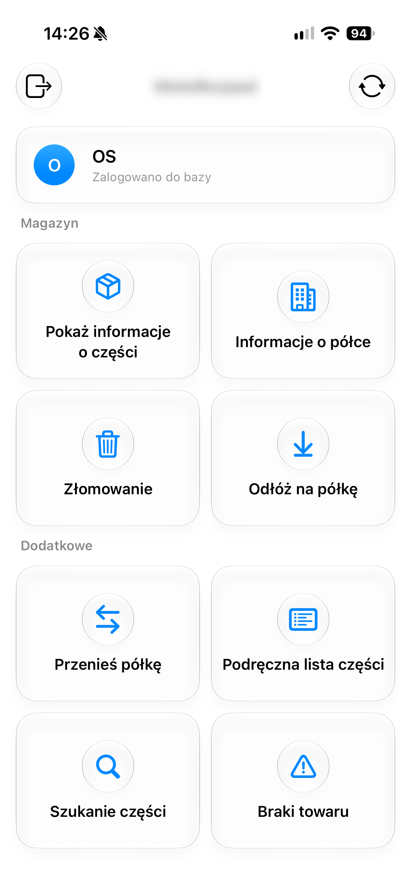
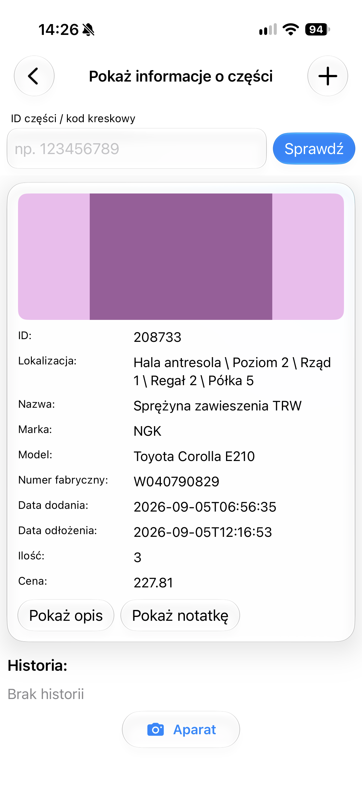
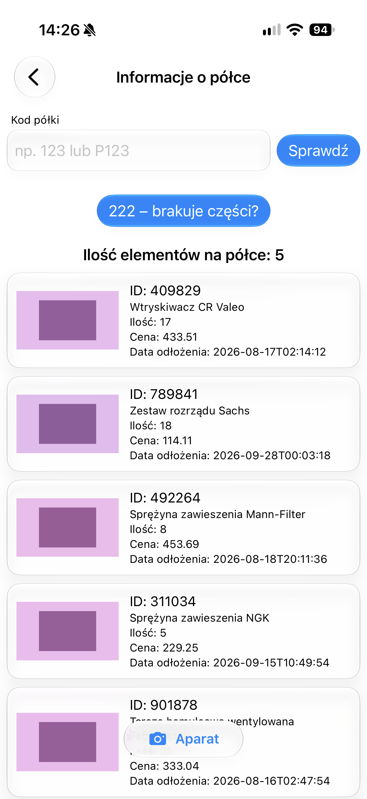
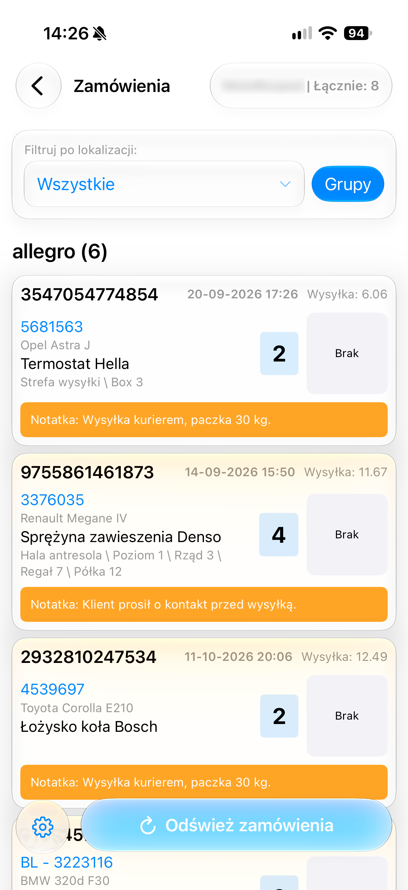

# DarTools Mobile — iOS

Port aplikacji magazynowej **DarTools Mobile** (Android/Kotlin/Compose) na iOS
(Swift/SwiftUI, Liquid Glass, iOS 26). Aplikacja stworzona przez AI w ramach testu narzędzia xtool.

# Aplikacja wymaga do pełnego działania ApiloHelperAPI (tba). Bez niego działają tylko podstawowe funckje systemu (informacje o części, odkładanie na półkę, złomowanie, informacje o półce)
# Kompatybilna z starym API Darsoftu (przed SDP v3)

## Funkcje

- **Logowanie** do API magazynowego (wiele profili/baz, zapisywane lokalnie)
- **Ekran główny** — kafelki do modułów, ostatnio skanowana część
- **Skanowanie aparatem** — QR/kod kreskowy (AVFoundation), pill kamerowy
- **Część** — info, zdjęcia, odłóż na półkę, przenieś, złomuj
- **Półka** — informacje o półce + ekran braków (polkoinator) z ponownym przypisaniem
- **Braki** — zamówienia z brakami z Apilo i Baselinker, auto-odświeżanie co 5 min
  z powiadomieniem systemowym (tylko przy zmianie liczby)
- **Szybkie części** — ostatnio skanowane, trwałe lokalnie
- **Ręczne wyszukiwanie** — OCR aparatem (Vision) + wyszukiwarka części
- **Tryb dummy** — losowe dane zamiast API, do robienia screenshotów

## Screeny

| Ekran główny | Informacje o części |
|---|---|
|  |  |

| Informacje o półce | Zamówienia (braki) |
|---|---|
|  |  |

## Wymagania

- Xcode 26 (SDK instalowane przez `xtool`, nie wymaga Xcode na hoście)
- [xtool](https://github.com/xtool-org/xtool) — build i instalacja na iPhonie
- konto Apple (sideload własnym certyfikatem)

## Build

```bash
# instalacja SDK z pobranego Xcode.xip (jednorazowo)
xtool sdk install /path/to/Xcode.xip

# build + ipa
xtool dev build -c release --ipa

# build i instalacja na podłączonym iPhonie
xtool dev run
```

Gotowe ipa: `xtool/DarToolsIOS.ipa`.

## Struktura

```
Sources/DarToolsIOS/
  DarToolsIOSApp.swift   — punkt wejścia, instalacja delegata powiadomień
  LoginView.swift        — logowanie + AppRoute (nawigacja)
  LoggedInView.swift     — ekran główny
  Api.swift, PartApi.swift, OrdersApi.swift   — klient API
  Prefs.swift            — UserDefaults (adresy API, users, przełączniki)
  Dummy.swift            — dane dummy
  Notifications.swift    — powiadomienia lokalne + auto-check braków
  CameraScanner.swift    — skaner QR/kodów
  CameraOcrScanner.swift — OCR aparatem (Vision)
  *View.swift            — ekrany
Info.plist               — nazwa, uprawnienia kamery, ATS (http)
Package.swift            — SwiftPM, iOS 26.0
xtool.yml                — konfiguracja xtool
```

## Uwagi

- API używa plain HTTP (header `Haslo`), stąd `NSAllowsArbitraryLoads` — apka
  i serwery są w sieci wewnętrznej.
- Tryb dummy: w Ustawieniach włącz „Tryb dummy" — adresy API uzupełniają się
  same (`dummy.local`), wszystkie odpowiedzi są losowane.
- Powiadomienia o brakach: wymagają włączenia „Auto-odświeżanie braków" w
  Ustawieniach; sprawdzenie działa tylko przy otwartej aplikacji (iOS nie ma
  tła w stylu Androida).
- Port pomija dodatki do drukarki Zebra (DataWedge) — brak odpowiedników na iOS.
